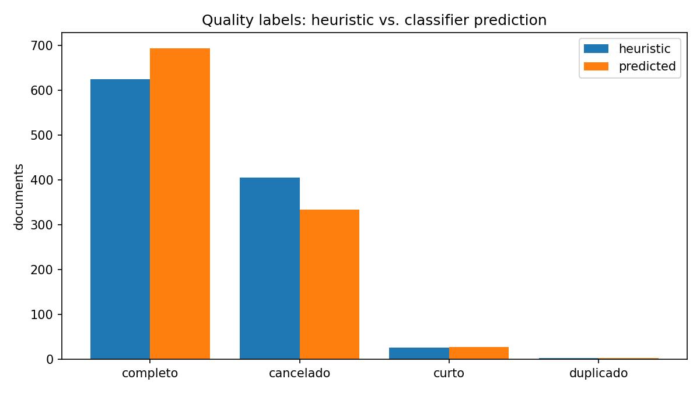
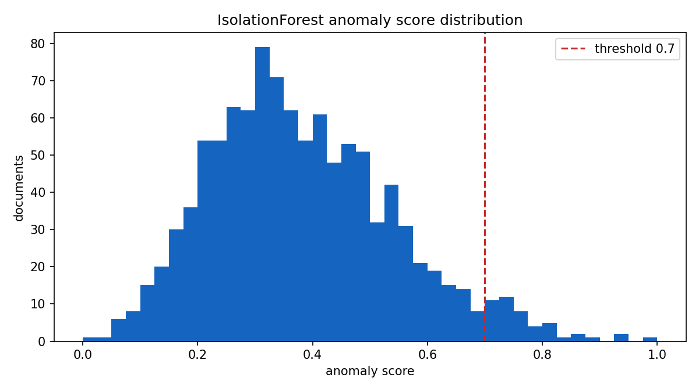
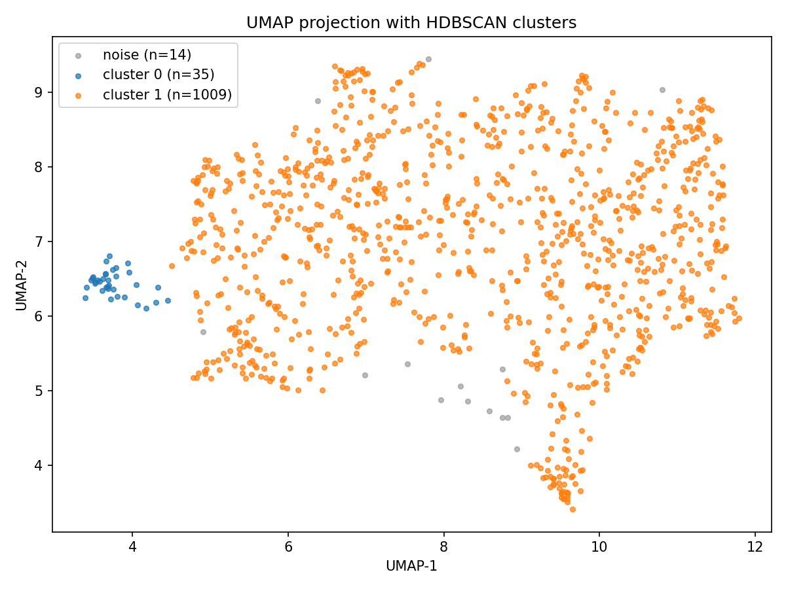

# Quality Control Analysis Report

## 1. Scope and objective

This report documents the quality control (QC) module of the TST jurisprudence
pipeline. It describes how candidate quality problems are detected, presents the
distributions and scores produced over the full corpus of 1058 verbetes, and
discusses the concrete anomalies that the module flags for manual review.

The module answers two complementary questions:

1. **Is this record structurally complete?** (heuristic rules + supervised
   classifier)
2. **Is this record unusual with respect to the rest of the corpus?**
   (unsupervised anomaly detection)

## 2. Method

### 2.1 Heuristic labelling

During ingestion each verbete receives a heuristic `quality_label`:

| Label | Rule |
|-------|------|
| `cancelado` | the text contains a cancellation marker (e.g. "cancelada") |
| `curto` | text length below `VERBETE_CURTO` (120 characters) |
| `ruido` | text length below `VERBETE_RUIDO` (30 characters) |
| `duplicado` | the body is repeated under more than one code |
| `completo` | none of the above |

### 2.2 Supervised re-labelling

A TF-IDF vectoriser (5000 features, 1-2 grams) feeds a Logistic Regression
(`class_weight="balanced"`) trained on the heuristic labels with an 80/20
stratified split. The fitted classifier then predicts the quality label for every
verbete, and the trained vectoriser and classifier are persisted to
`models/quality_classifier.joblib`.

### 2.3 Anomaly detection

An IsolationForest (200 trees, 5% contamination) is fitted on the 384-dimensional
sentence embeddings. Its decision function is rescaled to a 0-1 `anomaly_score`
(higher is more anomalous) and stored with each verbete.

### 2.4 How to read the metrics

- **Precision** - of the records the classifier *predicted* as a given class, the
  fraction that truly belong to it; it measures the trustworthiness of a positive
  prediction.
- **Recall** - of the records that *actually* belong to a class, the fraction the
  classifier found; it measures coverage.
- **F1** - the harmonic mean of precision and recall, a single balanced number.
- **Accuracy** - the fraction of all predictions that are correct; it can be
  misleading when classes are imbalanced, which is why F1 is also reported.
- **Macro F1** - the average F1 over classes, weighting every class equally, so a
  tiny class counts as much as a large one; it is low here because `curto` scores
  zero.
- **Weighted F1** - the average F1 weighted by class size, so it is dominated by
  the large classes. The gap between macro and weighted F1 quantifies how much
  the tiny classes hurt the average.
- **Anomaly score** - the IsolationForest output rescaled to 0-1, where higher
  means more unusual relative to the rest of the corpus. It is a *review cue*, not
  a judgment about legal validity.

### 2.5 Why these methods

- **TF-IDF + logistic regression** was chosen because it is fast, interpretable
  (you can inspect the learned word weights) and strong on this scale of data; a
  heavier model would be harder to justify with heuristic labels.
- **IsolationForest** is unsupervised, so it can flag novelty without any
  labels, complementing the supervised classifier.
- **UMAP + HDBSCAN** were chosen over PCA + k-means because UMAP preserves local
  neighbourhoods for visualisation, and HDBSCAN needs no preset number of
  clusters and marks outliers as noise.


## 3. Quality label distribution

{width=80%}

| Label | Heuristic | Predicted |
|-------|-----------|-----------|
| completo | 625 | 694 |
| cancelado | 405 | 334 |
| curto | 26 | 27 |
| duplicado | 2 | 3 |
| **Total** | **1058** | **1058** |

The classifier moves 71 documents from `cancelado` to `completo` and reassigns a
handful of short entries, reflecting the fact that the lexical cancellation
marker is not always a reliable indicator of an actually cancelled record.

## 4. Classifier evaluation

Held-out test split: 212 documents (846 for training).

| Metric | Value |
|--------|-------|
| Accuracy | 0.906 |
| F1 (macro) | 0.708 |
| F1 (weighted) | 0.896 |

Per-class results:

| Class | Precision | Recall | F1 | Support |
|-------|-----------|--------|----|---------|
| cancelado | 0.99 | 0.84 | 0.91 | 81 |
| completo | 0.87 | 0.98 | 0.92 | 125 |
| curto | 0.00 | 0.00 | 0.00 | 5 |
| duplicado | 1.00 | 1.00 | 1.00 | 1 |

The two dominant classes (`completo`, `cancelado`) are classified reliably. The
`curto` class is too small to be learned and is always missed, which drags the
macro F1 down; in practice short records are still surfaced by the length rule at
ingestion and by the anomaly score.

## 5. Anomaly detection

{width=80%}

- Mean anomaly score: 0.382.
- Documents above the 0.7 review threshold: **47 (4.4% of the corpus)**.

The top flagged records concentrate on historical Precedentes Normativos about
rural work, whose vocabulary differs sharply from the modern Súmulas and OJs.
The ten highest-scoring documents are:

| doc_id | tipo | orgao | quality | score |
|--------|------|-------|---------|-------|
| precedente_106 | precedente | SDC | completo | 1.000 |
| precedente_63 | precedente | SDC | completo | 0.949 |
| precedente_107 | precedente | SDC | completo | 0.936 |
| precedente_60 | precedente | SDC | completo | 0.896 |
| oj_sbdi-1_252 | oj | SBDI-1 | cancelado | 0.864 |
| precedente_115 | precedente | SDC | completo | 0.852 |
| sumula_83 | sumula | TST | cancelado | 0.829 |
| precedente_22 | precedente | SDC | completo | 0.824 |
| precedente_62 | precedente | SDC | completo | 0.822 |
| precedente_65 | precedente | SDC | curto | 0.816 |

Two representative flagged texts:

- `precedente_106` (score 1.000): "Os empregadores que se dedicarem à pecuária
  leiteira fornecerão, diariamente, 1 (um) litro de leite aos trabalhadores que
  exerçam atividades insalubres."
- `oj_sbdi-1_252` (score 0.864, `cancelado`): "DJ 20, 22 e 25.04.2005 O conceito
  de mesmo localidade de que trata o art. 461 da CLT..."

The module therefore satisfies the requirement of flagging at least one
anomalous or low-quality document, and in fact surfaces a coherent set of them.

## 6. Clustering quality

{width=80%}

The corpus splits into two dense clusters plus a small noise band:

| Cluster | Size | Top terms |
|---------|------|-----------|
| 1 | 1009 | art., res., para, decorrência, súmula |
| 0 | 35 | concede, homologação, res., sessão |
| noise | 14 | - |

Cluster 0 captures the historical rural-work precedentes, which is consistent
with the anomaly findings in section 5: the same records are both spatially
isolated and statistically unusual.

## 7. Findings and recommendations

1. **Cancelled records are the largest quality issue** (334 predicted, about 32%
   of the corpus). They should be filtered from any downstream legal search
   unless the user explicitly requests them.
2. **The `curto` class needs either more examples or a rule-based fallback**; the
   supervised classifier cannot learn it from five samples.
3. **Anomalies are mostly genuine and interpretable**, not noise: they are
   historical precedentes with a distinct legal vocabulary. They are good
   candidates for a dedicated "historical" collection rather than deletion.
4. **The noise band (14 points)** should be inspected manually; it may contain
   parsing artefacts.

## 8. Reproduction

```bash
cd capstone
make pipeline                 # produces the labels and scores
python scripts/make_report_figures.py   # regenerates the figures and summary.json
```

All numbers in this report are derived from `docs/figures/summary.json`, which
the figure script writes from the pipeline artifacts.
