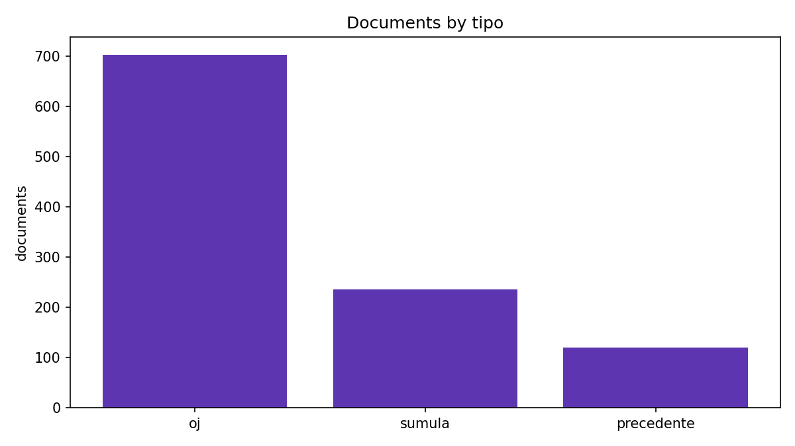
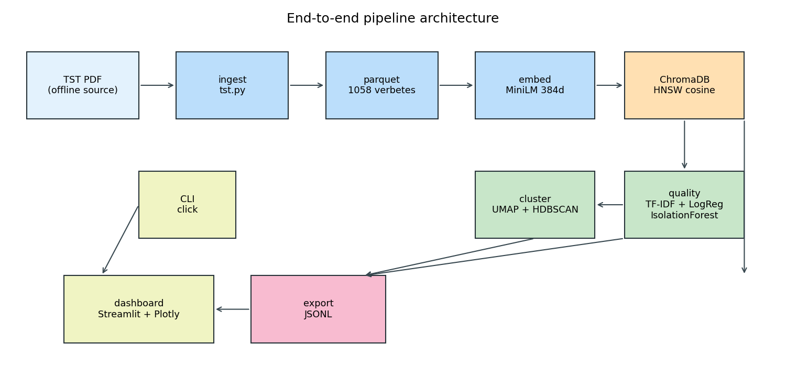
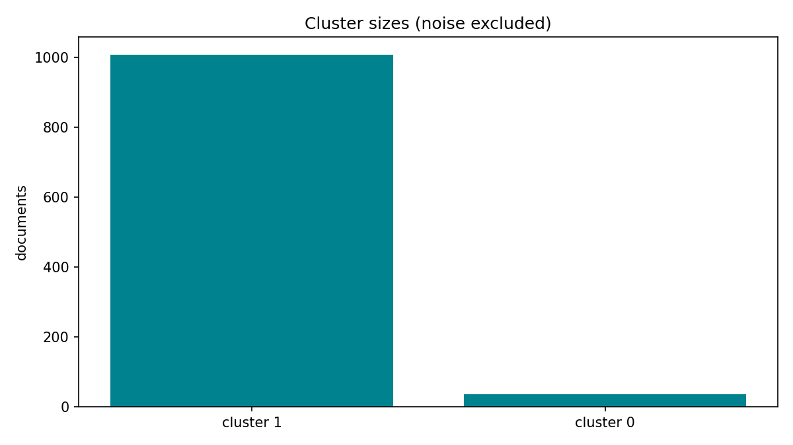

<!-- _paginate: false -->
<!-- _header: "" -->
<!-- _footer: "" -->

# TST Jurisprudence Explorer

### An interactive application to navigate a large legal corpus with embeddings and clustering

**CSDS-352 - Data Science and Machine Learning - Capstone Final**

Gustavo Henrique de Jesus da Silva

<!-- Presenter: greet the audience and give the one-sentence pitch. -->

---

## Agenda

1. The problem and the domain
2. The dataset
3. **Key concepts** (embeddings, vector search, UMAP, HDBSCAN, quality ML)
4. System architecture
5. Live demo (dashboard + CLI)
6. Results
7. Engineering: tests, CI, Docker
8. Limitations and future work

<!-- Plan: ~28 min. The live demo is the centerpiece (~8 min). Concept slides
are short and can be skimmed if you are running late. -->

---

## The problem

- The **Tribunal Superior do Trabalho (TST)** publishes a book of **Súmulas**,
  **Orientações Jurisprudenciais (OJs)** and **Precedentes Normativos (PNs)**.
- It ships as a dense **579-page PDF** in Portuguese.
- Each statement is mixed with its **historical redactions**, cross-references and
  cancellation notes.
- Finding related rulings by hand is slow, and there is no machine-readable
  version to search by meaning.

**One sentence:** we turn this legal PDF into a searchable, clustered and
quality-checked knowledge base.

---

## Domain and requirements

The project brief asks for a "document management system" with four parts:

| Requirement | How we address it |
|---|---|
| Ingestion pipeline (CLI + API) | `capstone` CLI, **PDF and plain-text** input |
| Knowledge base | **ChromaDB** vector store + metadata |
| Exploration interface | **Streamlit + Plotly** dashboard, semantic search |
| Quality control | **Heuristic labels + supervised classifier + anomaly detection** |

The domain is an **open-access official act**, so no copyrighted material is used.

---

## Dataset

- Source: TST *Livro de Súmulas, OJs e Precedentes Normativos* (public act).
- **1058 verbetes** segmented from the 579-page PDF.



Bars = documents per type: **703 OJs**, **235 Súmulas**, **120 Precedentes**.

<!-- "Verbere" = one numbered normative statement with type, body, theme. -->

---

## Concept: what is an "embedding"?

- An embedding is a **list of numbers (a vector)** that represents the *meaning*
  of a piece of text.
- Our model turns each verbete into **384 numbers**.
- Texts with similar meaning end up **close together** in this 384-dimensional
  space; unrelated texts end up far apart.

This is what lets us search by *meaning* rather than by exact keywords.

<!-- The numbers are learned from data, not designed by hand. -->

---

## How we embed

- Model: **`paraphrase-multilingual-MiniLM-L12-v2`** (Sentence-Transformers).
- **Multilingual** (trained on many languages) so Portuguese legal text works
  without fine-tuning.
- **384 dimensions**, runs on **CPU**, batched (32 at a time).
- We embed `tema` (theme) + `text` together, and **normalise** the vectors.

<!-- Transfer learning: we reuse a model pre-trained on a huge general corpus
instead of training our own from scratch. That is why 1058 documents are enough. -->

---

## Concept: cosine similarity and vector search

- **Cosine similarity** measures the **angle** between two vectors:
  `1.0` = same direction (very similar), `0.0` = unrelated.
- To search, we embed the query and return the verbetes whose vectors are
  closest to it.
- Because vectors are normalised, ranking by cosine similarity is a simple,
  fast operation.

**This is the core of "semantic search": we compare meaning, not words.**

---

## Concept: vector database (ChromaDB)

- A normal database stores rows; a **vector database** stores vectors and finds
  the **nearest neighbours** to a query vector, fast.
- We use **ChromaDB**, persisted on disk, with an **HNSW** index
  (a graph that speeds up approximate nearest-neighbour search).
- Distance space: **cosine**. Each record keeps its **metadata** (`tipo`,
  `orgao`, `codigo`, `tema`, quality label, cluster, anomaly score) so we can
  **filter** as well as search.

<!-- HNSW = Hierarchical Navigable Small World. It trades a tiny bit of accuracy
for a huge speed-up, which is standard for large vector collections. -->

---

## System architecture



`Ingest -> Embed -> ChromaDB -> Cluster -> Quality -> Export -> Interface`

---

## Pipeline stages

1. **Ingest** - segment PDF/plain text into verbetes, keep current wording.
2. **Embed** - 384-D multilingual vectors (theme + text).
3. **Store** - ChromaDB (HNSW, cosine) with metadata.
4. **Cluster** - UMAP projection + HDBSCAN.
5. **Quality** - heuristic labels, TF-IDF + logistic-regression classifier,
   IsolationForest anomalies.
6. **Export** - enriched JSONL that powers the dashboard.

Every stage runs alone *or* as one `capstone pipeline` command.

---

## Ingestion

- Parse with `pdfplumber`; detect headings per verbete type.
- Cut at `Histórico:` and repeated headers, stop at the subject index.
- Keep only the **current wording** of each verbete.
- Files detected by extension: **`.pdf`** or **`.txt`** (one verbete per line).
- Attach **heuristic quality labels** during ingestion (next concept slides).

---

## Live demo

<!-- Switch to the dashboard. Keep talking while it runs. -->

**Dashboard** (`capstone-dashboard` or `make dashboard`):

1. **Search** tab - semantic search, filters by type and quality.
2. **Cluster map** tab - UMAP scatter, cluster sizes, top terms.
3. **Quality & anomalies** tab - label mix, length histogram, top anomalies.

**Same engine via CLI:**

```bash
capstone search "adicional de insalubridade" -k 5
capstone clusters --top-terms 5
capstone anomalies --limit 10
capstone stats
```

---

## Concept: UMAP (dimensionality reduction)

- We cannot plot 384 dimensions. **UMAP** flattens them to **2D** while keeping
  nearby points nearby.
- Two knobs:
  - `n_neighbors=15` - balances **local** structure vs **global** structure.
  - `min_dist=0.1` - how tightly points may pack.
- We also cluster on the **2D UMAP coordinates**.

<!-- Caveat: the 2D picture is a lossy projection; distances are approximate. -->

---

## Clustering results


UMAP (`n_neighbors=15`, `min_dist=0.1`, cosine) + HDBSCAN (`min_cluster_size=15`):
**1009** main cluster, **35** historical, **14** noise.

**How to read:** `x`/`y` = UMAP-1/UMAP-2 (no units); colour = cluster, grey = noise; legend shows sizes.

---

## Concept: HDBSCAN (density-based clustering)

- Groups points that are **densely packed**, without being told how many
  clusters to expect.
- Handles **clusters of different sizes/densities** (unlike k-means).
- Points in sparse regions are labelled **noise (`-1`)** - honest about
  uncertainty.

Here most of the book shares one legal vocabulary (one big cluster), while a
small group of **historical rural-work precedentes** separates cleanly.

---

## Cluster sizes



Bars = documents per cluster (noise excluded).

- Cluster 1: **1009** verbetes - the general body of the book.
- Cluster 0: **35** verbetes - historical rural-work homologation language.
- Noise: **14** verbetes not dense enough to belong anywhere.

---

## Quality control: heuristic labels


**How to read:** blue = heuristic rule, orange = classifier prediction, per label.

Rules: cancelled/revoked keywords, duplicates, very short text, noise.

<!-- Heuristic: 625 completo, 405 cancelado, 26 curto, 2 duplicado. -->

---

## Concept: TF-IDF + logistic regression

- **TF-IDF** turns text into numbers: common words count little, rare and
  informative words count a lot. We use single words and pairs (1-2 grams),
  up to 5000 features.
- **Logistic regression** is a simple, fast linear classifier: it learns which
  words/pairs point to each quality label.
- `class_weight="balanced"` compensates for the rare classes.

This is **supervised learning** on labels we created with rules ("weak labels").

---

## Classifier results

Trained on the heuristic labels, evaluated on a held-out **20%** split:

| Class | Precision | Recall | F1 | n |
|---|---|---|---|---|
| cancelado | 0.99 | 0.84 | 0.91 | 81 |
| completo | 0.87 | 0.98 | 0.92 | 125 |
| curto | 0.00 | 0.00 | 0.00 | 5 |
| duplicado | 1.00 | 1.00 | 1.00 | 1 |

**Accuracy 0.91**, macro-F1 0.71, weighted-F1 0.90.

Honest note: the two tiny classes (5 and 1 examples) cannot be learned reliably.

---

## Concept: IsolationForest (anomaly detection)

- Builds many random **trees** that split the data.
- **Anomalies are isolated in fewer splits**, so they get a **higher score**.
- `contamination=5%` sets the expected outlier rate; `n_estimators=200` trees.
- Scores are normalised to **0-1** (higher = more anomalous).

It is **unsupervised**: nobody told it what an "anomaly" looks like.

---

## Anomalies found


**How to read:** `x` = score (0-1), `y` = documents, red dashed line = 0.7 threshold.

**47 verbetes (4.4%)** above 0.7; top hits are atypical historical precedentes.

<!-- Top hits: precedente_106 (1.00), precedente_63 (0.95), precedente_107 (0.94). -->

---

## Engineering quality

- **Tests:** 14 pytest cases, including an **offline end-to-end** pipeline run.
- **CI:** GitHub Actions (lint + strict typing) and GitLab CI (pipeline + tests).
- **Compliance:** `black` and `mypy` (strict) across the repository.
- **Docker:** `docker compose up --build` builds the pipeline, pre-loads the
  offline fixture and serves the dashboard - no network needed at runtime.

```bash
make test lint docs
docker compose up --build   # http://localhost:8501
```

---

## Reproducibility

```bash
capstone pipeline -i data/raw/livrointernet12pdf.pdf
make docs        # figures + PDF reports
make dashboard   # interactive UI
```

- Offline fixture (`tests/fixtures/tst-sample.pdf`, 22 verbetes) used by CI and
  Docker.
- Machine-readable results: `docs/figures/summary.json`.

---

## Limitations

- Quality labels are **heuristic**, not legally authoritative.
- The embedding model is **general-purpose**, not legal-domain fine-tuned.
- Tiny classes (`curto`, `duplicado`) are **not reliably learned**.
- Clustering is sensitive to density parameters and the 2D projection is lossy.
- Educational project - **no legal advice**.

---

## Future work

- Domain-tuned or legal Portuguese embeddings.
- **Active learning:** human corrections feed the classifier.
- Evaluate retrieval quality against a labelled relevance set.
- Larger corpora and incremental ingestion.
- Richer entity extraction (themes, dates, revocation graphs).

---

## Takeaways

- A complete pipeline from **raw PDF to interactive knowledge base**.
- Embeds, stores, visualises, clusters and **quality-checks** a real legal corpus.
- Reproducible, tested and containerised end to end.

**Thanks - questions?**

<!-- Backup slides follow; use only if asked. -->

---
<!-- _header: "Backup" -->

## Backup: command reference

```bash
capstone ingest -i data/raw/livrointernet12pdf.pdf -o data/processed/tst.parquet
capstone embed --batch-size 32
capstone cluster
capstone quality --contamination 0.05
capstone export -o data/final/tst.jsonl
capstone search "hora extra" -k 10
```

---
<!-- _header: "Backup" -->

## Backup: glossary

- **Embedding** - numeric vector for the meaning of a text.
- **Cosine similarity** - angle-based similarity between vectors (1 = same).
- **Vector DB / HNSW** - store and fast-nearest-neighbour search over vectors.
- **UMAP** - reduces many dimensions to 2 for visualisation.
- **HDBSCAN** - density-based clustering; marks sparse points as noise.
- **TF-IDF** - numeric text features weighting rare/informative words.
- **Logistic regression** - simple linear classifier.
- **IsolationForest** - unsupervised anomaly detector.
- **Transfer learning** - reusing a model pre-trained on a large general task.
