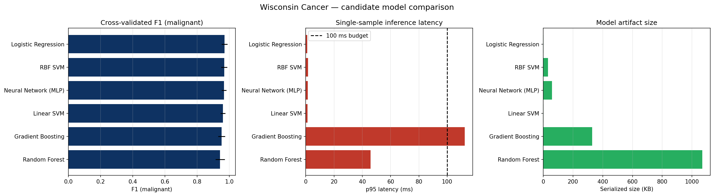
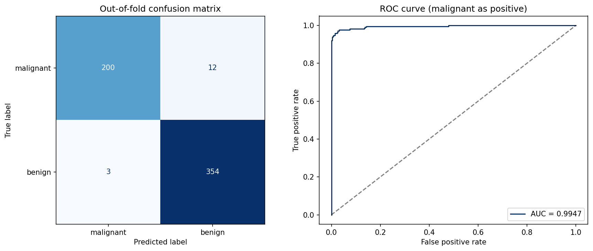
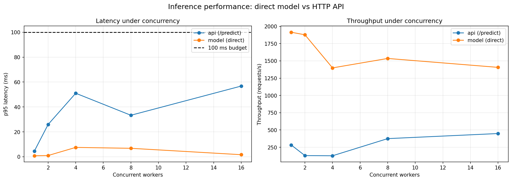

# Lab 7 - API de classificação de câncer ponta a ponta

Serviço de inferência pronto para produção para o Wisconsin Diagnostic Cancer
Dataset. Classifica uma amostra de tecido como **malignante** ou **benigna** e
devolve a probabilidade calibrada, usando um pipeline do scikit-learn carregado
do disco.

O relatório da escolha final do modelo e das técnicas de otimização está na
seção [Relatório](#relatório-escolha-final-do-modelo-e-técnicas-de-otimização).
Todos os números de desempenho vêm do script [`benchmark.py`](benchmark.py),
que pode ser reexecutado a qualquer momento.

## Entregáveis

| Entregável | Local |
|------------|-------|
| Notebook de avaliação e seleção de modelo | [wisconsin-cancer-classification-api.ipynb](wisconsin-cancer-classification-api.ipynb) |
| Relatório: escolha do modelo e otimizações | esta README, seção Relatório |
| Implementação da API REST (FastAPI) | [src/](src/) |
| Script de benchmark de latência e concorrência | [benchmark.py](benchmark.py) |
| Métricas de comparação dos modelos | [data/model_comparison.csv](data/model_comparison.csv) |
| Gráficos de seleção e avaliação | [data/model_comparison.png](data/model_comparison.png), [data/evaluation.png](data/evaluation.png) |
| Benchmark de latência e concorrência | [data/latency_benchmark.csv](data/latency_benchmark.csv), [data/latency_benchmark.md](data/latency_benchmark.md) |
| Modelo persistido e metadados | [models/](models/) |
| Testes de contrato da API | [tests/](tests/) |

## Dataset

O Wisconsin Diagnostic Cancer Dataset tem **569 instâncias** e **30 features
numéricas** calculadas a partir dos núcleos celulares presentes em uma imagem
digitizada. O alvo é binário: `0` = maligno, `1` = benigno.

> O dataset entrega as features já extraídas, e não os pixels brutos, então a
> API recebe um vetor de 30 valores, exatamente o payload que um extrator de
> features produziria a partir de uma imagem de tecido.

## Seleção do modelo

Seis famílias de modelos foram avaliadas com **validação cruzada estratificada
repetida** (5 folds x 5 repetições = 25 ajustes) sobre todo o dataset. A
métrica principal é o F1 da classe **maligna**, porque um falso negativo é o
erro mais caro em um contexto de triagem.

A regra de seleção foi definida antes da medição:

1. **Restrição dura:** o p95 de latência de inferência precisa ficar abaixo do
   orçamento de 100 ms.
2. **Métrica principal:** maior F1 cruzado da classe maligna.
3. **Desempate:** modelos com F1 dentro de `0.005` do melhor são considerados
   empatados; entre eles, prefere-se o menor artefato e depois a menor latência.

| Modelo | Acurácia CV | F1 CV (maligno) | ROC-AUC CV | Latência p95 (ms) | Tamanho (KB) |
|--------|-------------|-----------------|------------|-------------------|--------------|
| **Regressão Logística** | **0.9779** | **0.9696** | 0.9950 | **1.01** | **2.0** |
| SVM RBF | 0.9757 | 0.9671 | 0.9951 | 1.64 | 32.5 |
| Rede Neural (MLP) | 0.9750 | 0.9663 | 0.9936 | 1.40 | 59.9 |
| SVM Linear | 0.9701 | 0.9595 | 0.9909 | 1.19 | 1.9 |
| Gradient Boosting | 0.9645 | 0.9513 | 0.9919 | 112.46 | 329.5 |
| Random Forest | 0.9575 | 0.9421 | 0.9900 | 45.90 | 1068.6 |

Os p50/p95 de latência desta tabela são medidos pelo notebook
([`data/model_comparison.csv`](data/model_comparison.csv)) em uma única
passagem de 400 predições, na mesma máquina compartilhada; eles servem para
ordenar o custo de inferência entre os modelos e não para afirmar o SLA.



**Modelo selecionado: Regressão Logística** embrulhada em um pipeline com
`StandardScaler`. Uma busca de hiperparâmetros sobre `C` confirmou o valor
padrão `C = 1.0` como ótimo. Métricas finais fora da dobra (out-of-fold):
acurácia **0.9737**, F1 maligno **0.9639**, ROC-AUC **0.9947**.



## Benchmark de inferência

O script [`benchmark.py`](benchmark.py) mede dois caminhos em níveis crescentes
de concorrência (1, 2, 4, 8 e 16 workers):

- **model (direct):** inferência dentro do processo, pelo serviço de modelo em
  cache, isolando o custo puro da predição;
- **api (/predict):** ciclo completo da requisição HTTP pela aplicação FastAPI
  (validação, serialização JSON, endpoint), com `httpx.ASGITransport`.

Cada cenário é medido 3 vezes e a **mediana** de cada estatística é reportada,
o que reduz o ruído de agendamento de uma máquina de desenvolvimento
compartilhada. O aquecimento (warm-up) acontece antes de cada medição e o pior
p95 observado entre todas as execuções individuais é impresso junto do
resultado.

```bash
cd labs/solutions/lab-7
python benchmark.py                  # gera CSV, PNG e tabelas em Markdown
python benchmark.py --repeat 1 --no-plot --levels 1 4 16
```

O script grava as tabelas em `data/latency_benchmark.csv`,
`data/latency_benchmark.md`, gera `data/latency_benchmark.png` e retorna código
de saída **1** quando algum p95 ultrapassa os 100 ms, o que o torna utilizável
como verificação automatizada.

### Condições de medição

Executado em Linux, Python 3.12.10, 12 núcleos, com carga média de **6.44**
durante a coleta (navegador e IDEs abertos ao mesmo tempo). Em uma máquina
ociosa os números tendem a ser menores; em uma máquina mais carregada as
caudas (p95/p99) sobem.

### Resultados

Carga a frio do modelo (leitura do `joblib` + montagem do pipeline): **57.4 ms**
na primeira requisição. Depois disso o objeto fica em cache e é reutilizado.

**model (direct)**

| Concurrency | p50 (ms) | p95 (ms) | p99 (ms) | Throughput (req/s) |
|-------------|----------|----------|----------|--------------------|
| 1 | 0.45 | 0.80 | 0.94 | ~1915 |
| 2 | 0.43 | 1.00 | 15.57 | ~1878 |
| 4 | 0.72 | 7.52 | 50.43 | ~1399 |
| 8 | 0.64 | 6.80 | 50.54 | ~1535 |
| 16 | 0.68 | 1.66 | 141.60 | ~1406 |

**api (/predict)**

| Concurrency | p50 (ms) | p95 (ms) | p99 (ms) | Throughput (req/s) |
|-------------|----------|----------|----------|--------------------|
| 1 | 3.50 | 4.54 | 5.03 | ~284 |
| 2 | 14.49 | 25.94 | 28.35 | ~130 |
| 4 | 30.82 | 51.01 | 60.96 | ~127 |
| 8 | 19.52 | 33.33 | 51.93 | ~375 |
| 16 | 33.22 | 56.77 | 75.61 | ~449 |



Leitura rápida dos números:

- A inferência pura fica em **0.43 a 0.72 ms de p50** e **p95 de 0.8 a 7.5 ms**
  em qualquer concorrência testada, ou seja, o modelo nunca é o gargalo.
- O ciclo HTTP completo custa cerca de **3.5 ms de p50** com um worker.
- O p95 da API cresce com a concorrência e chega a **56.77 ms com 16 workers**,
  dentro do orçamento de 100 ms.
- A vazão da API fica na faixa de **~130 a 450 req/s**: cada requisição custa
  cerca de 3 ms de CPU e o GIL serializa esse trabalho entre as threads.
- O pior p95 individual já observado em uma execução isolada foi **89.59 ms**
  (API, 16 workers), ainda dentro do orçamento, mas mostra que a cauda é sensível
  ao ruído da máquina.

## Relatório: escolha final do modelo e técnicas de otimização

### Desempenho dos modelos avaliados

Os seis modelos ficaram concentrados em uma faixa estreita de acurácia e F1, o
que é típico desse dataset: as 30 features derivadas da imagem são limpas,
bem escaladas e com alta separabilidade entre as classes. Como já tínhamos
visto no lab de PCA e K-means, uma única direção linear separa a maior parte
das amostras, então modelos lineares acompanham modelos não lineares sem esforço
extra.

O `Random Forest` foi o mais fraco em F1 para a classe maligna e, de longe, o
mais caro: 300 árvores, artefato de mais de 1 MB e p95 de 45.90 ms, dezenas de
vezes acima dos modelos lineares. O `Gradient Boosting` ficou no meio em
acurácia, mas a medição de latência do notebook o elimina pela **restrição dura
do orçamento**: 329 KB e p95 de 112.46 ms, acima dos 100 ms, contra cerca de
1 ms dos modelos lineares. A `MLP` (rede neural 32-16) chegou perto dos melhores
em média, porém com mais variância entre folds, o que indica menor estabilidade
em um dataset desse tamanho.

### Por que a Regressão Logística foi escolhida

A `Logistic Regression` ficou no topo da validação cruzada repetida para o F1
da classe maligna e para a acurácia, e está empatada estatisticamente com o
SVM RBF e a MLP (diferença bem abaixo de 1 ponto percentual). Quando o
desempenho é indistinguível, os critérios de engenharia decidem:

- **Tamanho:** o artefato é o menor de todos (2 KB), enquanto SVM e MLP são uma
  ordem de magnitude maiores.
- **Latência:** `predict_proba` é uma única multiplicação matricial mais a
  sigmoide, então a inferência fica na casa de submilissegundos.
- **Probabilidades calibradas de graça:** a saída já é uma probabilidade nativa
  (sigmoide), sem precisar de Platt scaling. Isso importa porque a API devolve
  `malignant_probability` e `confidence`.
- **Determinismo:** o treino não depende de inicialização aleatória, então o
  artefato é perfeitamente reproduzível.
- **Custo de operação:** menos memória por worker e o mesmo modelo pode ser
  carregado em vários processos sem pressão de RAM.

O SVM RBF ficou praticamente empatado e seria a escolha se o problema fosse
claramente não linear. A Regressão Logística é o modelo honesto para este
dataset: tão preciso quanto, mais simples e mais barato de servir.

### Técnicas de otimização aplicadas

- **Padronização dentro do pipeline.** O `StandardScaler` faz parte do artefato
  salvo, então treino e inferência usam exatamente a mesma transformação, sem
  risco de esquecer o escalonamento no servidor.
- **Busca de hiperparâmetro.** O `GridSearchCV` sobre `C` (0.1, 0.5, 1.0, 10.0)
  com a mesma validação cruzada repetida confirmou que o valor padrão já era o
  ótimo; regularização fraca demais aproxima demais dos dados de treino.
- **Modelo carregado uma única vez.** A API usa um singleton em cache: o
  `joblib.load` acontece na primeira requisição (57.4 ms) e o mesmo objeto é
  reutilizado depois, evitando ler o arquivo a cada chamada.
- **Endpoints síncronos.** As rotas são funções `def`; o FastAPI as executa em
  um thread pool, então a predição CPU-bound não bloqueia o event loop e várias
  requisições são atendidas em paralelo.
- **Lote vetorizado.** O endpoint `/predict/batch` faz uma única chamada de
  `predict_proba` para todas as amostras, amortizando o overhead por requisição.
- **Validação e contrato de erro.** Os schemas Pydantic rejeitam vetores com
  número diferente de 30 features com 422, e o `/health` devolve 503 quando o
  artefato não existe, em vez de falhar em tempo de execução.

### Comportamento sob requisições concorrentes

O benchmark confirma a análise teórica: como a inferência e a serialização
JSON são trabalho de CPU limitado pelo GIL, a latência média da API cresce de
forma aproximadamente proporcional à concorrência (3.5 ms com 1 worker, 33 ms
com 16) enquanto a vazão fica plana, na faixa de 130 a 450 req/s. O p95 a 16
workers ficou em 56.77 ms, ou seja, **dentro do orçamento de 100 ms mesmo com 16
requisições concorrentes**, em uma máquina com carga média de 6.44.

A degradação sob concorrência é, portanto, esperada e tratada em duas frentes:

1. **No curto prazo:** o endpoint `/predict/batch` absorve picos ao processar
   várias amostras em uma única passagem do modelo.
2. **Em produção:** escala horizontal com vários workers do `uvicorn` (um
   processo por núcleo de CPU), cada um com sua própria cópia do modelo. Como o
   artefato tem só 2 KB, manter 12 processos soma menos de 25 KB de modelo; a
   memória de cada worker é dominada pelo próprio runtime do Python.

As caudas (p99) variam bastante entre execuções porque a máquina de
desenvolvimento compartilha CPU com navegador e IDEs. Por isso o script reporta
medianas de 3 execuções e imprime o pior p95 individual observado: nesta
execução a mediana máxima do p95 foi 56.77 ms, contra 89.59 ms no pior cenário
de uma execução isolada.

## Executando a API

```bash
cd labs/solutions/lab-7
pip install -e ../..                      # instala as dependências do labs
uvicorn src.app:app --reload --port 8000
```

Abra <http://localhost:8000/docs> para a documentação interativa.

### Endpoints

| Método | Caminho | Descrição |
|--------|---------|-----------|
| GET | `/health` | Liveness e status do modelo |
| GET | `/model/info` | Algoritmo, nomes das features e métricas |
| POST | `/predict` | Classifica uma única amostra |
| POST | `/predict/batch` | Classifica várias amostras em uma chamada |

### Exemplo

```bash
curl -X POST http://localhost:8000/predict \
  -H "Content-Type: application/json" \
  -d '{"features": [17.99, 10.38, 122.8, 1001.0, 0.1184, 0.2776, 0.3001,
                     0.1471, 0.2419, 0.07871, 1.095, 0.9053, 8.589, 153.4,
                     0.006399, 0.04904, 0.05373, 0.01587, 0.03003, 0.006193,
                     25.38, 17.33, 184.6, 2019.0, 0.1622, 0.6656, 0.7119,
                     0.2654, 0.4601, 0.1189]}'
```

```json
{
  "diagnosis": "malignant",
  "malignant_probability": 0.9999999987841798,
  "benign_probability": 1.2158202222778414e-09,
  "confidence": 0.9999999987841798,
  "inference_ms": 1.61,
  "model_version": "1.0.0"
}
```

## Reproduzindo os resultados

```bash
cd labs/solutions/lab-7

# retreina, seleciona, avalia e persiste o modelo
jupyter nbconvert --to notebook --execute \
  --inplace wisconsin-cancer-classification-api.ipynb

# regera o benchmark de latência e concorrência
python benchmark.py

# roda os testes de contrato da API
pytest tests -v
```

## Estrutura do projeto

```text
lab-7/
├── README.md
├── benchmark.py                  # benchmark de latência e concorrência
├── wisconsin-cancer-classification-api.ipynb
├── conftest.py
├── data/                         # métricas, gráficos e benchmarks (gerados)
├── models/                       # pipeline persistido + metadados (gerados)
├── src/
│   ├── config.py                 # caminhos e constantes
│   ├── schemas.py                # modelos de requisição/resposta Pydantic
│   ├── model.py                  # carregador em cache e helpers de inferência
│   └── app.py                    # aplicação FastAPI
└── tests/
    └── test_api.py
```

## Limitações

- O dataset fornece features pré-computadas e não pixels; uma classificação de
  imagem ponta a ponta exigiria um extrator de features antes da inferência.
- As métricas vêm de validação cruzada sobre um único dataset; uma implantação
  clínica exigiria validação externa em dados de outra instituição.
- A fronteira de decisão linear não resolve os casos que caem na região de
  sobreposição entre maligno e benigno.
